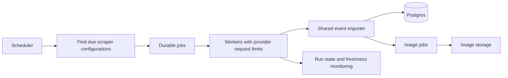

# Scraper scalability review

Reviewed November 18, 2026 (America/New_York).

Follow-up: [the revised implementation plan](scraper-implementation-plan.md) narrows the immediate scope to 50–100 configurations using small resumable batches, four scheduling fields, and one runner lock. The larger queue and managed-runner options below are future considerations, not requirements for this first version.

## Recommendation

Refactor scheduling and execution before expanding to hundreds of places. Keep the provider parsers and existing application/database stack. Make each scraper configuration an independently tracked, retryable job, with shared provider request limits and a separate image-processing stage.

The current design is reasonable for a small catalog. It has a fixed runtime ceiling, incomplete failure recovery, and limited freshness monitoring. Adding cities mostly adds configuration rows; the scaling problem is how all those rows execute inside one provider-wide HTTP request.

This was a source review plus aggregate queries against the database configured in `.env.local`, using read-only transactions. No scrapers were executed, application behavior changed, or database records modified. The current production deployment, its environment variables, Vercel plan, and deployment logs were not verified. Historical measurements below are not a benchmark of the current code.

## Current setup

`vercel.json` defines five daily triggers:

| Job | Configured UTC time |
| --- | --- |
| DICE | 02:00 |
| Posh | 02:10 |
| Ticketmaster | 02:20 |
| Eventbrite | 02:30 |
| Recurring-event materialization | 08:00 |

These are UTC expressions, not city-local schedules. See [Vercel cron documentation](https://vercel.com/docs/schedules/cron-jobs). On Hobby, invocations can occur anywhere within the scheduled hour, so the ten-minute offsets do not guarantee separation; see [cron accuracy](https://vercel.com/docs/schedules/cron-jobs/manage-cron-jobs#cron-jobs-accuracy).

The scraper route requests a 300-second maximum duration. Each invocation:

1. Finds an admin account for attribution.
2. Scans all stored events for the provider and repairs external images.
3. Loads every scraper configuration for that provider, across all cities.
4. Runs configurations sequentially, performing fetching, reconciliation, event persistence, category writes, and image hosting.
5. Writes a log after each configuration finishes.

There is no durable pending-job list, checkpoint, lease, retry schedule, per-configuration cadence, or city partition. Posh only executes if `POSH_CRON_ENABLED` is explicitly `true`. The scraper query does not filter disabled places; one current Ticketmaster configuration belongs to a disabled place.

Evidence: `src/app/api/cron/run-scrapers/[scraper]/route.ts:27`, `:641`, `:658`, `:661`, `:690`, `:711`, `:763`; configuration schema at `src/server/db/schema.ts:584`.

## Database observations

The configured database contained 27 scraper configurations:

| Provider | Configurations | Configurations for enabled places | Historical mean per run | Historical p95 per run | Latest recorded run |
| --- | ---: | ---: | ---: | ---: | --- |
| DICE | 1 | 1 | 0.831 s | 3.116 s | September 1, 2026 |
| Posh | 9 | 9 | 9.736 s | 56.471 s | August 27, 2026 |
| Ticketmaster | 14 | 13 | 0.683 s | 1.488 s | September 1, 2026 |
| Eventbrite | 3 | 3 | 1.282 s | 2.906 s | September 1, 2026 |

Timings aggregate all available logs since March 26, except Eventbrite, whose history begins August 27. Posh had 144 errors across 912 recorded runs; Ticketmaster had 40 across 1,752. These are historical results, not current failure rates.

There were no logs in the preceding 14 days, and two current configurations had never logged a run. The data cannot confirm that scheduled imports are currently healthy. First establish whether this database is the one used by production; if it is, investigate the missing scheduled activity before adding cities. Manual imports do not write these cron logs, so absent cron logs do not prove all ingestion stopped.

The database contained 2,320 events, including 1,951 with scraper sources. That volume alone provides no evidence of a database capacity problem. The configured connection URL uses the pooled hostname, and the live database has the expected unique `(source, external_id)` index. Scraper logs currently have only their primary-key index.

## Capacity and failure limits

### 1. The Ticketmaster provider-wide batch will exceed its runtime budget

The loop waits three seconds after each Ticketmaster configuration, less any time spent logging, before starting the next. The wait plus logging therefore adds at least approximately three seconds per gap. This limit applies to Ticketmaster configurations across all cities, rather than the total number of places across all providers.

Using the historical 0.683-second mean as an illustration:

`batch seconds ≈ 0.683 × configurations + 3 × (configurations − 1)`

| Ticketmaster configurations | Estimated batch time, excluding image repair and other overhead |
| ---: | ---: |
| 50 | 3 min 1 s |
| 100 | 6 min 5 s |
| 200 | 12 min 14 s |
| 500 | 30 min 39 s |

At 101 configurations, the inter-configuration gaps alone consume at least 300 seconds. Current provider-wide limits therefore cannot support hundreds of Ticketmaster configurations in one invocation. The historical mean would exhaust the budget near 82 configurations even before overhead; that is an optimistic arithmetic bound, not a safe operating target.

The three-second pause also does not implement a provider request limit: each configuration makes a venue lookup and then an events request with no shared request-level limiter. Persisting the resolved Ticketmaster venue ID would remove a repeated lookup and reduce ambiguous venue matching. Honor actual account quotas and response headers when choosing limits; provider documentation has inconsistent per-second defaults, so do not derive a limit from the existing sleep.

Evidence: cron route `:688–707`; `src/app/api/scrape-ticketmaster/route.ts:454–524`. [Ticketmaster quota headers](https://developer.ticketmaster.com/products-and-docs/apis/getting-started/) and [current FAQ](https://developer.ticketmaster.com/support/faq/).

### 2. A failed or timed-out batch has no durable continuation

Provider-fetch failures are caught per configuration, and insert failures have a local catch. Failures during reconciliation, category writes, some image-related database work, or log insertion can escape and abort the whole provider run. A timeout can leave earlier writes committed and later configurations unattempted. There is no progress cursor or stable ordering to guarantee which work resumes next.

[Vercel does not retry failed cron invocations, and cron delivery can be missed or duplicated](https://vercel.com/docs/schedules/cron-jobs/manage-cron-jobs). Completed logs cannot distinguish every missing run from an unattempted or interrupted run. Existing unique source IDs help with duplicate insertion, but do not make every later category/link/image step recoverable: for example, categories are attached only to newly inserted rows.

### 3. Historical image work competes with fresh event ingestion

Before scraping, image repair loads all events for a provider, including expired events, then filters external URLs in application memory. Its four-worker limit bounds uploads, but the query and historical workload remain unbounded. Repeated image failures can consume the next day's budget again.

Inside each scraper, image lookup and upload work uses `Promise.all`/`Promise.allSettled` over the full result set. DICE detail requests are also launched for the full event list. More concurrent scraper jobs would multiply those bursts unless inner concurrency is bounded too. Image conversion uses Sharp and can consume significant memory and CPU during large imports.

Move new/changed image processing to separate retryable jobs, deduplicated by event and source image. Run historical repair as a paginated maintenance task with its own budget. The event can be saved before its hosted image is ready.

Evidence: `src/server/utils/scraped-event-images.ts:89–132`; cron route `:566–620`; `src/app/api/scrape-dice/route.ts:173–211`; `src/lib/s3.ts:375`.

### 4. More cities introduce data-quality issues as well as runtime load

- **Posh defaults missing locations to Boston, MA.** Those nonempty defaults prevent the cron's place-location fallback from correcting the location. Remove the hard-coded city/state defaults before enabling other cities. Use explicit unknown location handling and linked-place fallbacks only where appropriate. Evidence: `src/app/api/scrape-posh/route.ts:853–857`, `:1251`; cron route `:294–302`.
- **Pagination can silently omit events.** Ticketmaster requests one page of up to 100 raw events and ignores pagination. Eventbrite reads at most 20 pages, filters past events after retrieval, and does not report when more pages remain. Larger venues or long organizer histories can make omissions more likely. Add complete/incomplete results and resumable pagination; avoid treating incomplete listings as complete synchronization. Evidence: Ticketmaster `:498–524`; Eventbrite `:133–163`.
- **Existing events receive only selected updates.** The cron inserts with `onConflictDoNothing`, then updates location, relationships, some organizer fields, and images. It does not provide full reschedule/cancellation synchronization: provider `eventStatus` is ignored and inserts use `status: "active"`. Manual import has separate optional overwrite behavior. Define source-owned fields and editorial overrides in one shared importer. Evidence: cron route `:280–300`, `:414–539`; mobile importer `:985–1013`; tRPC event router `:1409–1436`.
- **Venue matching repeatedly loads all venues.** Each organizer run loads the global venue catalog and scans it for each event. Restrict candidates with reliable location information and prefer stable provider venue mappings. Same-state venues with identical names can currently produce an unresolved match. Evidence: cron route `:205–269`.
- **Concurrent reconciliation needs care.** Current cross-source matching reads a venue/time slot and may replace its source identity. A unique `(source, external_id)` index prevents duplicate identities within a provider, but does not make cross-provider matching atomic. Address this before increasing worker concurrency. A future source-record table can retain multiple provider identities for one canonical event.

The Resident Advisor prototype is separate from production ingestion: it is not in the scraper enum, scheduler, or persistence pipeline. Its documented live-access and pagination work remains necessary independently of scheduling changes. See `docs/resident-advisor-scraper.md`.

## Proposed design

Use one job per scraper configuration and scheduled period, with a unique deduplication key. A city is configuration and reporting metadata; it does not need its own cron route. Page-heavy providers can checkpoint pages or split them into child jobs while tracking whether the listing completed.

The scheduler should quickly enqueue due work and return. Track `enabled`, scheduling cadence, `nextRunAt`, `lastAttemptAt`, `lastSuccessAt`, consecutive failures, and provider identifiers. A scheduler that reconciles overdue work can catch up after a missed trigger. Enqueue confirmation and schedule advancement must be coordinated so a failed enqueue does not lose the job.

Workers need bounded global concurrency, per-provider/API-key request pacing shared across workers, per-configuration overlap protection, deadlines, and retries with backoff/jitter for transient failures. Honor `Retry-After`; distinguish invalid configurations from transient failures. Keep a visible failed-job state after retry exhaustion. If implementing leases, make them expire and recover after worker death.

A managed durable job runner is a good fit for the existing Next.js/Vercel application. For example, [Inngest supports durable steps and retries](https://www.inngest.com/docs/platform-overview), [concurrency limits](https://www.inngest.com/docs/durable-execution/flow-control/concurrency), and [start throttling](https://www.inngest.com/docs/durable-execution/flow-control/throttling). Start throttling alone does not limit individual HTTP requests inside a job; account for that explicitly. Keep each hosted step within its platform duration limit. A database-backed queue is also feasible, but requires implementing dispatch, leases, recovery, and worker execution.

Preserve the existing source identity index, batch existing-event lookups, and bound database operations. Add indexes guided by these queries: `(scraper_id, ran_at DESC)` and `ran_at` for run history; `(venue_id, start_at, end_at)` for slot lookups if query plans justify it. Give logs a retention policy and avoid retaining full event lists indefinitely. Hundreds of daily configurations generate hundreds of thousands of log rows per year, depending on cadence and configurations per place.

The recurring-series cron also loads all active series and loops sequentially. It should eventually use jobs per series or bounded batches with progress tracking. It does not share the scraper route's explicit 300-second configuration, so verify its deployed duration separately.

## Recommended rollout

1. **Establish current health.** Identify the deployed database and configuration; verify cron invocations and Posh enablement. Track attempts before work begins and completions afterward. Alert on overdue successful runs, not just thrown errors. Fix incorrect partial-success reporting and surface swallowed link/image failures.
2. **Unify the import path and fix expansion blockers.** Extract provider fetchers from API route files and share the importer between cron, mobile, and web admin. Remove Boston defaults, report pagination completeness, honor enable/disable controls, and define update/cancellation rules. Ensure retries can repair partially completed category/link work.
3. **Introduce durable jobs before the large city rollout.** One configuration per job, provider-level limits, overlap protection, retry policy, and a separate image queue. Migrate a provider incrementally, keeping one active schedule owner to avoid duplicate processing.
4. **Validate expansion with realistic fixtures and recorded pages.** Exercise 100–500 configurations without issuing a load test against provider websites. Test timeouts, rate limits, worker interruption, repeated delivery, incomplete pages, overlapping organizer/venue listings, reschedules, cancellations, and location/timezone differences. Then canary a small live subset within provider quotas.

Suggested acceptance targets: every enabled scraper becomes due and receives an attempt; successful freshness meets its configured cadence plus an explicit grace period; failures are visible and retriable; queued work drains well before the next scheduled period; repeated delivery leaves events and categories consistent; image failures do not block event ingestion. Measure queue age, per-provider p50/p95 duration, HTTP requests per job, database load, and image processing time before increasing concurrency or refresh frequency.

Raising `maxDuration` or splitting a provider into city batches can provide temporary headroom. Neither adds durable recovery or protects external services. The permanent change should make total catalog size affect queue drain time instead of requiring the entire provider catalog to fit inside one request. [Vercel's duration documentation](https://vercel.com/docs/functions/configuring-functions/duration) describes the current plan-specific limits; the repository currently requests five minutes regardless of higher limits that may be available.
